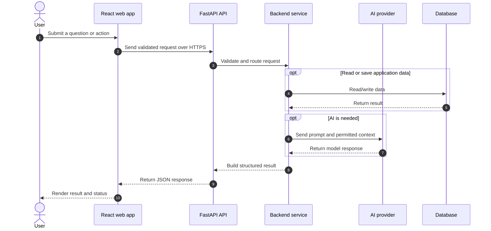
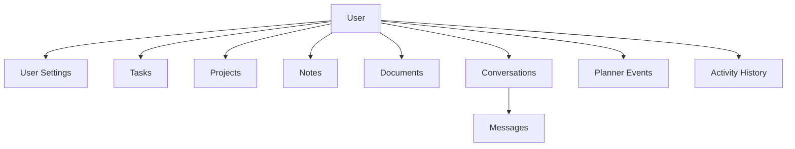

# CognifyOS — Your Personal AI Ecosystem

<p align="center">

**One workspace for productivity, learning, research, development, and personal automation.**

Bring your AI assistants, everyday tools, and personal knowledge together in one place.

</p>

---

## 🚀 Overview

CognifyOS is a personal productivity platform designed to bring common activities—chatting, studying, managing tasks, taking notes, researching, and planning—into a unified workspace.

The project combines a React frontend with a planned FastAPI backend and AI services. The frontend provides the application experience; backend, database, and AI integrations are being developed progressively. Diagrams below show the intended architecture, not a claim that every integration is already implemented.

### 🎯 Vision

Build a personal AI workspace that helps users organize knowledge, make progress on daily work, and automate repetitive tasks—with the user remaining in control.

---

## ✨ Features

| Area | What it is for |
|---|---|
| **AI Chat** | Ask questions, solve problems, and review conversations. Context-aware memory is planned. |
| **Tasks** | Create tasks, track completion, and organize priorities and deadlines. |
| **Study Assistant** | Explore difficult concepts and support structured learning and exam preparation. |
| **Project Assistant** | Plan projects, break work into manageable tasks, and get development guidance. |
| **Documents** | Organize files; AI-powered document summaries and Q&A are planned. |
| **Research Assistant** | Structure research and summarize topics; external research integrations are planned. |
| **Notes** | Create and organize personal knowledge. |
| **Daily Planner** | Plan schedules, activities, and routines. |
| **History** | Review previous activities and interactions. |
| **Settings** | Manage application preferences and supported data exports. |

---

## 🧠 System Architecture

This diagram shows how the planned system components fit together. A request enters through the web app, reaches the API, and is routed to application services. AI and database access happen on the backend; secrets such as the Gemini API key should never be exposed in the browser.

```mermaid
flowchart LR
    person([User])

    subgraph client[Client — React and Vite]
        ui[Web app and dashboard]
        modules[Chat · Tasks · Study · Projects<br/>Documents · Research · Notes · Planner]
        browserState[Client state and preferences]
        ui --> modules
        modules <--> browserState
    end

    subgraph server[Backend — FastAPI]
        api[REST API]
        validation[Validation and application logic]
        services[Feature services]
        auth[Authentication and authorization<br/>(planned)]
        ai[AI service and agent workflows<br/>(planned)]
        persistence[Data access layer<br/>SQLAlchemy (planned)]
        api --> validation
        validation --> auth
        validation --> services
        services --> ai
        services --> persistence
    end

    model[Gemini API<br/>(external AI provider)]
    db[(SQLite<br/>(initial database plan))]

    person --> ui
    modules <-->|HTTPS / JSON| api
    ai <-->|AI request and response| model
    persistence <-->|Read and write| db
```

### Request lifecycle

For an AI-assisted action, the intended request and response path is:



> **Status:** The diagrams describe the target design. Backend routes, authentication, persistence, and AI integrations should be treated as planned until implemented and tested.

---

## 🛠️ Technology Stack

### Frontend

| Technology | Purpose |
|---|---|
| React.js | Component-based user interface |
| Vite | Development server and build tooling |
| JavaScript | Application logic |
| CSS3 | Styling and responsive layouts |
| React Router | Client-side navigation |
| Lucide React | Interface icons |
| LocalStorage | Initial client-side preferences/data where appropriate |

### Backend and AI (planned architecture)

| Technology | Purpose |
|---|---|
| Python and FastAPI | Backend and REST API |
| Uvicorn | ASGI server |
| Pydantic | Request and response validation |
| SQLAlchemy and SQLite | Data access and initial database |
| Python-dotenv | Environment configuration |
| Google Gemini API | AI-powered responses |
| Agents, tools, memory, and RAG | Future specialized AI workflows |

### Development Tools

Visual Studio Code · Git · GitHub · Postman · Python virtual environment · npm

---

## 📂 Intended Project Structure

The structure below is the intended architecture and may differ from the current repository while development is in progress.

```text
AetherMind/                       # GitHub repository
├── frontend/
│   ├── public/
│   └── src/
│       ├── assets/
│       ├── components/
│       ├── pages/
│       ├── layouts/
│       ├── context/
│       ├── services/
│       ├── hooks/
│       ├── App.jsx
│       └── main.jsx
├── backend/
│   ├── api/
│   ├── agents/
│   ├── tools/
│   ├── database/
│   ├── models/
│   ├── schemas/
│   ├── services/
│   ├── utils/
│   ├── main.py
│   └── config.py
├── data/                          # Local data; do not commit private user files
├── logs/
├── tests/
├── .env.example
├── .gitignore
├── requirements.txt
└── README.md
```

---

## 🔌 Planned API Design

These are example route groups for the planned backend, not a guarantee that every endpoint exists today.

| Module | Example route | Purpose |
|---|---|---|
| Authentication | `/api/auth/` | Sign-in and user access |
| AI Chat | `/api/chat/` | Conversations |
| Tasks | `/api/tasks/` | Task management |
| Study | `/api/study/` | Learning assistance |
| Projects | `/api/projects/` | Project planning |
| Documents | `/api/documents/` | Document operations |
| Research | `/api/research/` | Research workflows |
| Notes | `/api/notes/` | Note management |
| Planner | `/api/planner/` | Daily planning |
| History | `/api/history/` | Activity history |
| Settings | `/api/settings/` | User preferences |

---

## 🗄️ Data Model (Planned)

The initial local-development database plan uses SQLite with SQLAlchemy. Potential entities include users, conversations, messages, tasks, projects, notes, documents, research records, planner events, activity history, and user settings.



This is a conceptual relationship map. Exact fields, constraints, and relationships will be decided when the database schema is implemented.

---

## 💻 Installation and Setup

### Prerequisites

- Node.js and npm
- Python 3.10+
- Git

### 1. Clone the repository

```bash
git clone https://github.com/im-vishal-jain/AetherMind.git
cd AetherMind
```

### 2. Run the frontend

```bash
cd frontend
npm install
npm run dev
```

Vite prints the local development URL in the terminal.

### 3. Run the backend

In a second terminal, from the repository root:

```bash
cd backend
python -m venv venv
```

Activate the virtual environment:

```bash
# Windows CMD
venv\Scripts\activate

# macOS / Linux
source venv/bin/activate
```

Install dependencies and start the API:

```bash
pip install -r ../requirements.txt
uvicorn main:app --reload
```

If the backend structure and dependencies are in place, the API documentation is available at `http://127.0.0.1:8000/docs`.

> These instructions follow the intended layout above. Adjust commands if the current repository structure differs.

---

## 🔐 Environment and Security

Create a local `.env` file based on `.env.example` (if available). Keep secrets on the backend and out of version control.

```env
APP_NAME=CognifyOS
DEBUG=True
DATABASE_URL=sqlite:///./cognifyos.db
GEMINI_API_KEY=your_gemini_api_key
SECRET_KEY=replace_with_a_secure_random_value
```

- Never commit `.env` files, API keys, or private user documents.
- Never put provider credentials in frontend code.
- Use strong, randomly generated secrets outside local development.
- Validate input and apply authentication/authorization before exposing private data.
- Review logging so credentials and sensitive user content are not recorded.

---

## 🧪 Testing Strategy

- **Frontend:** component rendering, navigation, form validation, interactions, and responsive layouts.
- **Backend:** request validation, API behavior, database operations, authentication, and error handling.
- **AI:** response quality, context handling, tool behavior, and timeout/failure handling.
- **Integration:** frontend/backend communication, persistence, AI provider connectivity, and end-to-end workflows.

---

## 🗺️ Roadmap

### Phase 1 — Frontend
- [x] Dashboard and sidebar navigation
- [x] AI Chat interface
- [x] Tasks, Study Assistant, and Project Assistant interfaces
- [x] Documents, Research, Notes, and Daily Planner interfaces
- [x] History and Settings interfaces

### Phase 2 — Backend Foundation
- [ ] FastAPI setup and configuration
- [ ] Database connection and SQLAlchemy models
- [ ] Pydantic schemas and API architecture

### Phase 3 — AI Integration
- [ ] Gemini API integration
- [ ] Chat backend and conversation history
- [ ] Context-aware memory
- [ ] Agent architecture and tool calling

### Phase 4 — Application Integration
- [ ] Authentication
- [ ] Tasks, Notes, Projects, and Study APIs
- [ ] Documents, Research, Planner, and Settings APIs
- [ ] Frontend/backend integration

### Phase 5 — Advanced AI Ecosystem
- [ ] Multi-agent orchestration
- [ ] Retrieval-Augmented Generation (RAG)
- [ ] Document intelligence and workflow automation
- [ ] Long-term memory and personalized assistance

### Phase 6 — Production Readiness
- [ ] Automated testing
- [ ] Security hardening
- [ ] Performance optimization
- [ ] Deployment, monitoring, and logging

---

## 🔮 Future Scope

Possible future capabilities include voice interaction, personal knowledge search, document Q&A, automated research workflows, AI-assisted scheduling, external application integrations, personalized learning recommendations, and cross-module automation. Any actions that affect user data or external services should be clearly visible and require appropriate user approval.

---

## 🤝 Contributing

Contributions, ideas, and improvements are welcome:

1. Fork the repository.
2. Create a feature branch.
3. Make and test your changes.
4. Open a pull request with a clear description.

---

## 📜 License

This project is under development. Add a license file before distributing the project under open-source terms.

---

<p align="center">

**Building a smarter digital workspace, one feature at a time.**

*Think. Learn. Create. Automate.*

</p>
